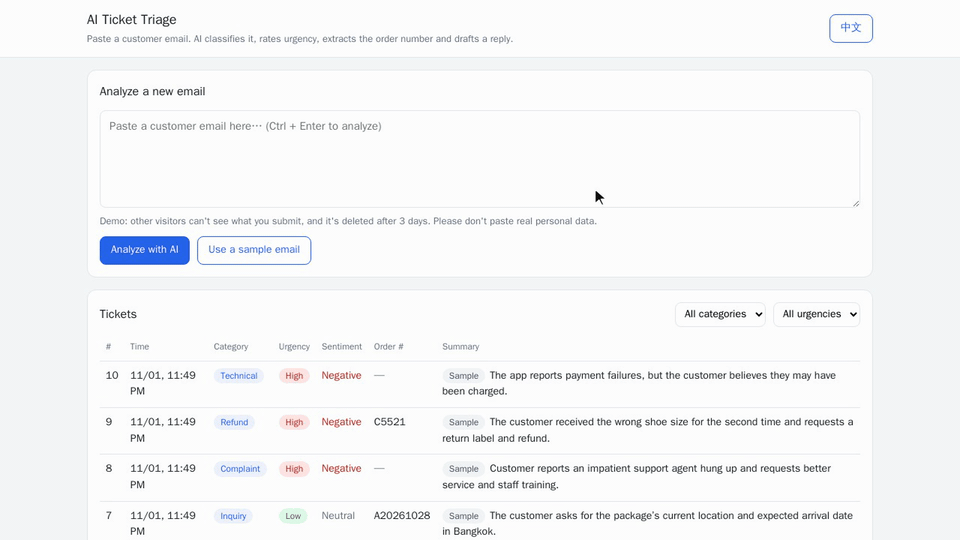
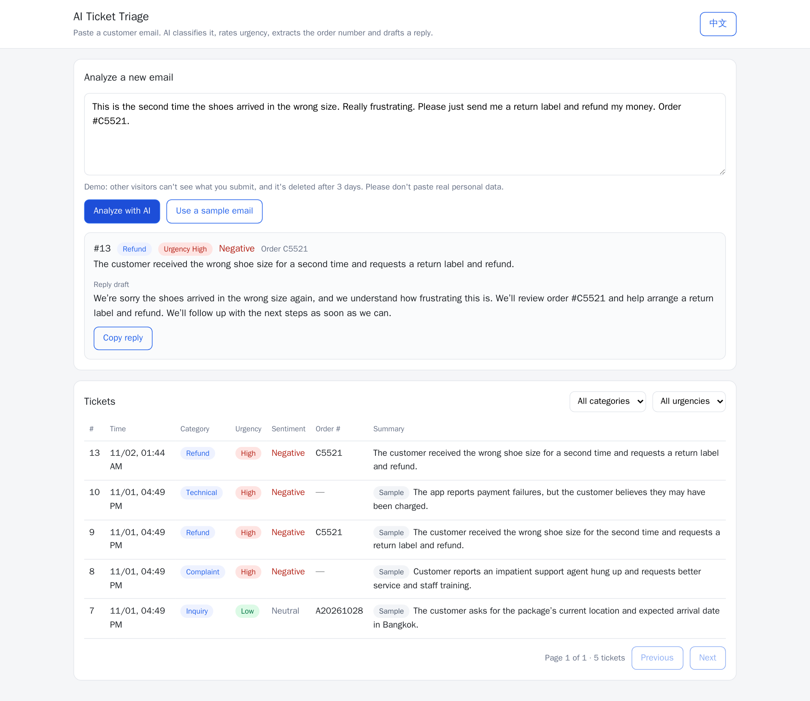
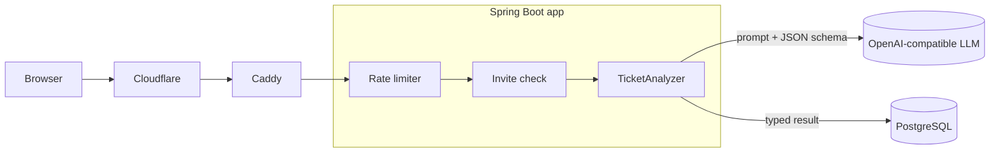

# AI Ticket Triage

[](https://github.com/archeu/ai-ticket-triage/actions/workflows/ci.yml)

English | [中文](README.zh-CN.md)

Paste a customer support email and get back its **category, urgency, sentiment, order number, a one-line summary and a reply draft**. One LLM call returns a typed Java object, which is saved to PostgreSQL and shown in a filterable ticket list.

Built with **Spring Boot 4 + Spring AI 2**. It works with any OpenAI-compatible model, including self-hosted ones.

**Live demo: https://triage.ainiya.de**
Sample results are public. Running your own emails through the AI needs an invite link to protect the API budget; message me and I'll send you one.



## What it does

- Sorts support emails into Inquiry, Complaint, Refund, Technical or Other
- Rates urgency (Low, Medium, High) and customer sentiment
- Extracts the order number. Cleanup is done in code, not by the AI, so `#C5521` always becomes `C5521`
- Writes the summary in the support agent's UI language and the reply draft in the customer's language
- Ticket list with category and urgency filters and pagination; English and Chinese UI



## How it works



Spring AI's structured output does the heavy lifting. It generates a JSON schema from a Java record, sends it along with the prompt, and maps the model's answer back onto the record (simplified):

```java
public record TicketAnalysis(Category category, Urgency urgency, Sentiment sentiment,
                             String orderNumber, String summary, String replyDraft) {}

TicketAnalysis analysis = chatClient.prompt()
        .user(userMessage)
        .call()
        .entity(TicketAnalysis.class);
```

`Category`, `Urgency` and `Sentiment` are enums, so the model can't invent new values. The system prompt is a plain text file in `src/main/resources/prompts/`, so prompt changes don't touch Java code.

## Built like a real service

| Concern | How it's handled |
| --- | --- |
| API cost and abuse | Per-IP rate limits (5 per minute, 30 per day) plus a global daily cap; returns HTTP 429 with `Retry-After` |
| Access | Invite codes with per-code daily limits. Requests without a valid code never reach the LLM |
| Privacy | Each visitor sees only their own tickets plus the public samples. Anyone else's ticket returns 404. Demo data is deleted after 3 days |
| IP spoofing | `X-Real-IP` is trusted only when the request comes from the local reverse proxy |
| Secrets | API keys and database passwords come from environment variables and are never in the repo |
| Model choice | Any OpenAI-compatible endpoint, public API or self-hosted. Switching means changing three environment variables |
| Deployment | Multi-stage Docker build, non-root container, Docker Compose with PostgreSQL. The app port is bound to localhost behind Caddy and Cloudflare |
| Quality | Labeled evaluation emails and a regression script, re-run after every prompt change. Unit tests plus MockMvc integration tests (with the AI mocked) for invite codes, visitor isolation, validation and rate limits; CI runs them on every push |

## Tech stack

Java 21 · Spring Boot 4.1 · Spring AI 2.0 · Spring Data JPA · PostgreSQL 17 · Docker Compose · plain HTML and JavaScript

## Run it locally

You need Docker and an API key for any OpenAI-compatible model.

```bash
git clone https://github.com/archeu/ai-ticket-triage.git
cd ai-ticket-triage

export LLM_BASE_URL=https://api.openai.com/v1   # your provider's base URL, keep the /v1
export LLM_API_KEY=your-api-key
export LLM_MODEL=your-model-name
export POSTGRES_PASSWORD=change-me
export TRIAGE_INVITE_REQUIRED=false             # no invite codes needed locally

docker compose up -d --build
```

Then open http://localhost:8081.

**For development** (Java 21 and a running PostgreSQL), set `DB_URL`, `DB_USER` and `DB_PASSWORD` as well as the `LLM_*` variables, then run:

```bash
./mvnw spring-boot:run -Dspring-boot.run.profiles=dev   # http://localhost:8080, relaxed limits, no invite codes
./mvnw test                                             # uses in-memory H2, no API key needed
python3 eval/run_eval.py                                # regression run over eval/emails/
```

## API

| Method and path | What it does |
| --- | --- |
| `POST /api/tickets` | Analyze an email and save it. Body: `{"email": "...", "summaryLanguage": "en"}`. Headers: `X-Invite-Code` (when required), `X-Visitor-Id` |
| `GET /api/tickets?category=REFUND&urgency=HIGH&lang=en&page=0&size=20` | List the tickets this visitor can see, newest first |
| `GET /api/tickets/{id}` | Get one ticket; returns 404 if it isn't yours |
| `GET /api/access` | Report whether an invite is required and whether yours is valid |

Example:

```bash
curl -s http://localhost:8081/api/tickets \
  -H 'Content-Type: application/json' \
  -d '{"email": "This is the second time the shoes arrived in the wrong size. Please refund my money. Order #C5521.", "summaryLanguage": "en"}'
```

```json
{
  "id": 13,
  "category": "REFUND",
  "urgency": "HIGH",
  "sentiment": "NEGATIVE",
  "orderNumber": "C5521",
  "summary": "The customer received the wrong shoe size for a second time and requests a return label and refund.",
  "replyDraft": "We're sorry the shoes arrived in the wrong size again, and we understand how frustrating this is. ...",
  "createdAt": "2026-11-02T01:44:12Z",
  "sample": false
}
```

## Project layout

```
ai-ticket-triage/
├── src/main/java/io/github/archeu/triage/
│   ├── ai/            TicketAnalyzer (Spring AI call), TicketAnalysis (structured output type)
│   ├── config/        TriageProperties (typed settings), WebMvcConfig
│   ├── controller/    REST endpoints only, no business logic
│   ├── dto/           request and response records; entities never leave the service layer
│   ├── entity/        JPA entities and enums
│   ├── exception/     custom exceptions and GlobalExceptionHandler (one error format)
│   ├── job/           hourly cleanup of old demo data
│   ├── ratelimit/     fixed-window rate limiter and its interceptor
│   ├── repository/    Spring Data repositories and query specifications
│   └── service/       business logic: tickets and invite codes
├── src/main/resources/
│   ├── prompts/       system prompt, editable without touching Java
│   └── static/        UI: index.html, css/, js/
├── src/test/java/     unit tests and MockMvc integration tests
├── eval/              labeled emails (expected category in the file name) and run_eval.py
├── samples/           public sample emails shown on the live demo (zh, en)
├── scripts/           run locally, deploy, seed samples, manage invites
├── docs/images/       screenshots and GIFs for this README
├── .github/workflows/ CI: build and test on every push
├── Dockerfile
└── compose.yaml
```

## About me

I'm a Java backend developer who adds AI features to existing Java systems: classification and data extraction, knowledge-base Q&A (RAG), and AI support chatbots. Want something like this in your system? Contact details are on my GitHub profile.
