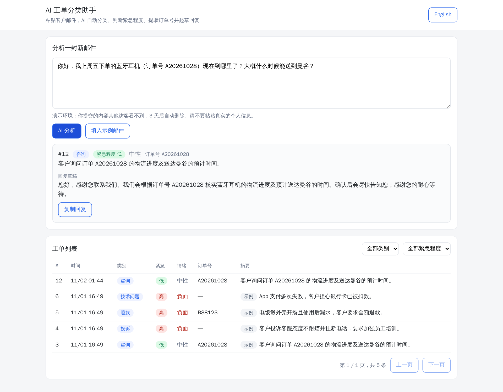
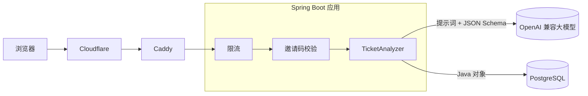

# AI 工单分类助手

[English](README.md) | 中文

粘贴一封客户邮件，AI 返回**类别、紧急程度、客户情绪、订单号、一句话摘要和回复草稿**。一次大模型调用拿回一个 Java 对象，直接存进 PostgreSQL，并在可筛选的工单列表里显示。

技术上用 **Spring Boot 4 + Spring AI 2**，可以接任何 OpenAI 兼容接口的模型，包括私有化部署的模型。

**在线演示：https://triage.ainiya.de**
示例结果公开可看。为了保护 AI 额度，用自己的邮件调用 AI 需要邀请链接，联系我发给你。



## 能做什么

- 把客服邮件分成咨询、投诉、退款、技术问题、其他
- 判断紧急程度（低、中、高）和客户情绪
- 提取订单号。格式清理放在代码里做，不交给 AI，所以 `#C5521` 一定会变成 `C5521`
- 摘要用客服界面的语言，回复草稿用客户邮件的语言
- 工单列表可以按类别、紧急程度筛选，支持分页；界面中英文切换

## 怎么实现的



核心是 Spring AI 的结构化输出：根据 Java record 自动生成 JSON Schema，和提示词一起发给模型，再把模型返回的 JSON 转回这个 record（简化版）：

```java
public record TicketAnalysis(Category category, Urgency urgency, Sentiment sentiment,
                             String orderNumber, String summary, String replyDraft) {}

TicketAnalysis analysis = chatClient.prompt()
        .user(userMessage)
        .call()
        .entity(TicketAnalysis.class);
```

`Category`、`Urgency`、`Sentiment` 都是枚举，模型没法编出新的取值。

## 按真实服务的标准来做

| 关注点 | 做法 |
| --- | --- |
| AI 费用和滥用 | 每个 IP 每分钟 5 次、每天 30 次，全站每天有总上限；超出返回 HTTP 429 和 `Retry-After` |
| 访问控制 | 邀请码，每个码有每日次数上限。没有有效邀请码的请求走不到大模型 |
| 数据隔离 | 每个访客只看到自己提交的工单和公开示例，访问别人的工单返回 404；演示数据 3 天后自动删除 |
| 伪造 IP | 只有来自本机反向代理的请求，才信任 `X-Real-IP` |
| 密钥 | API Key 和数据库密码都从环境变量读取，不进代码仓库 |
| 模型可替换 | 任何 OpenAI 兼容接口，公有云或私有化部署都行，换模型只改三个环境变量 |
| 部署 | Docker 多阶段构建，容器内用非 root 用户；Docker Compose 带 PostgreSQL；应用端口只绑定本机，前面是 Caddy 和 Cloudflare |
| 质量 | 带标注的样例邮件加回归脚本，每次改提示词都重跑；限流和邀请码次数有单元测试 |

## 技术栈

Java 21 · Spring Boot 4.1 · Spring AI 2.0 · Spring Data JPA · PostgreSQL 17 · Docker Compose · 原生 HTML 和 JavaScript

## 本地运行

需要 Docker，以及任意一家 OpenAI 兼容接口的 API Key。

```bash
git clone https://github.com/archeu/ai-ticket-triage.git
cd ai-ticket-triage

export LLM_BASE_URL=https://api.openai.com/v1   # 换成你的提供商地址，保留 /v1
export LLM_API_KEY=your-api-key
export LLM_MODEL=your-model-name
export POSTGRES_PASSWORD=change-me
export TRIAGE_INVITE_REQUIRED=false             # 本地运行不需要邀请码

docker compose up -d --build
```

然后打开 http://localhost:8081。

**开发模式**（需要 Java 21 和一个运行中的 PostgreSQL）：除了 `LLM_*`，再设置 `DB_URL`、`DB_USER`、`DB_PASSWORD`，然后：

```bash
./mvnw spring-boot:run -Dspring-boot.run.profiles=dev   # http://localhost:8080，限流放宽，不需要邀请码
./mvnw test                                             # 用内存数据库 H2，不需要 API Key
python3 scripts/try-analyze.py                          # 用 samples/ 里的邮件跑一遍回归
```

## 接口

| 方法和路径 | 作用 |
| --- | --- |
| `POST /api/tickets` | 分析一封邮件并保存。请求体：`{"email": "...", "summaryLanguage": "zh"}`；请求头：`X-Invite-Code`（需要邀请码时）、`X-Visitor-Id` |
| `GET /api/tickets?category=REFUND&urgency=HIGH&lang=zh&page=0&size=20` | 列出当前访客能看到的工单，最新的在前 |
| `GET /api/tickets/{id}` | 查看一个工单；不是自己的返回 404 |
| `GET /api/access` | 返回是否需要邀请码、当前邀请码是否有效 |

示例：

```bash
curl -s http://localhost:8081/api/tickets \
  -H 'Content-Type: application/json' \
  -d '{"email": "你好，我上周五下单的蓝牙耳机（订单号 A20261028）现在到哪里了？大概什么时候能送到曼谷？", "summaryLanguage": "zh"}'
```

```json
{
  "id": 12,
  "category": "INQUIRY",
  "urgency": "LOW",
  "sentiment": "NEUTRAL",
  "orderNumber": "A20261028",
  "summary": "客户询问订单 A20261028 的物流进度及送达曼谷的预计时间。",
  "replyDraft": "您好，感谢您联系我们。我们会根据订单号 A20261028 核实蓝牙耳机的物流进度及预计送达曼谷的时间……",
  "createdAt": "2026-11-02T01:44:05Z",
  "sample": false
}
```

## 项目结构

```
src/main/java/com/example/triage/
  TicketAnalyzer.java      提示词和结构化输出
  TicketController.java    REST 接口和访客隔离
  RateLimiter.java         按 IP 和全站限流（固定时间窗口）
  InviteService.java       邀请码和每日次数
  TicketCleanup.java       每小时清理过期的演示数据
src/main/resources/static/index.html    单页界面（中英文）
samples/                   带标注的测试邮件，文件名里是正确类别
scripts/                   启动、评测、部署、管理邀请码
```

## 关于我

我是 Java 后端工程师，专门给现有的 Java 系统加上 AI 能力：智能分类和信息提取、企业知识库问答（RAG）、AI 客服。想在你的系统里做类似的功能？联系方式在我的 GitHub 主页。
